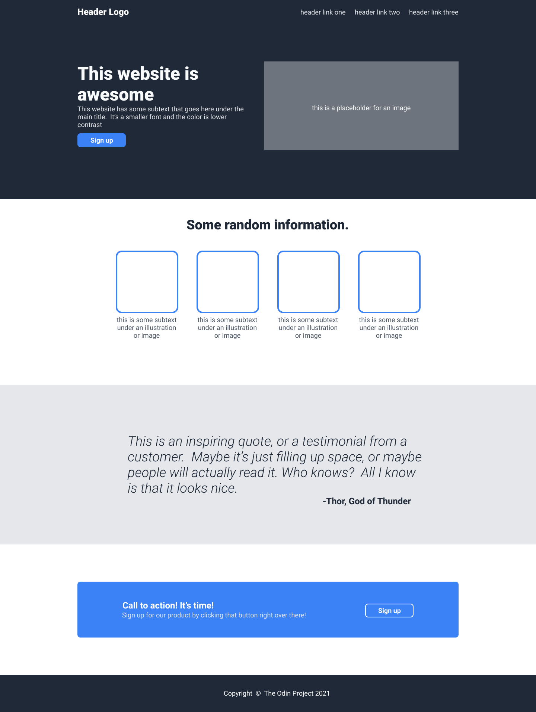

# Odin Landing Page

## Preview

## About

My second project from The Odin Project Foundations course.

Unlike my first project, Odin Recipes, which primarily focused on HTML structure and basic page creation, this project challenged me to build a complete landing page using both HTML and CSS.

This is my first major project involving layout design, styling, spacing, and Flexbox.

## Skills Practiced

- Semantic HTML
- CSS Fundamentals
- Flexbox Layouts
- Page Structure
- Spacing & Alignment
- Git & GitHub Workflow

## Reflection

This project helped me gain confidence in building complete web page layouts from a design reference. It was my first experience working extensively with Flexbox to create and organize different sections of a webpage.

As I continue learning, I plan to revisit this project and improve it with modern responsive design techniques and additional refinements.

## Author

**Amaan Khan**

GitHub: https://github.com/ammucodes